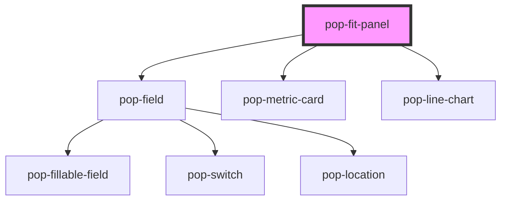

# pop-fit-panel

<!-- Auto Generated Below -->

## Overview

pop-fit-panel — the health panel (organism): six tappable metric cards, an
inline log form (opens in an action zone above the grid), the readings-by-day
list, and three consolidated trend charts (weight line + goal, blood-sugar
line + normal-range band, calories bars + goal) — all three via one
`pop-line-chart`. Forms use `pop-field`; the emoji glyphs are kept as-is.

Presentation-only: the HOST (the Bucket Hub's hub-fit) owns the network
(hubApi), optimistic mutations, day/state and the PanelShell chrome. This
component displays the data it is handed and emits `pop*` events:
  • popCardTap(cardKey)  — a metric card was tapped (host opens/closes its form)
  • popLog(payload)      — submit the active card's form ({card, values, at})
  • popCancelLog         — dismiss the open form
  • popDayChange(day)    — the built-in date pill picked a day (header mode)
  • popRefresh           — refresh requested

Object/array props accept a value (property binding) OR a JSON string
(attribute — how Storybook / plain HTML pass them), parsed defensively.

The user/child switcher of the old monolith is intentionally GONE — the panel
is single-user (owner).

## Properties

| Property         | Attribute          | Description                                                                                                                                                                                         | Type                          | Default                                             |
| ---------------- | ------------------ | --------------------------------------------------------------------------------------------------------------------------------------------------------------------------------------------------- | ----------------------------- | --------------------------------------------------- |
| `activeCard`     | `active-card`      | The card whose log form is open (''=none). Controlled by the host.                                                                                                                                  | `string`                      | `''`                                                |
| `caloriesSeries` | `calories-series`  | Calories-per-day bars (object array OR JSON string).                                                                                                                                                | `FitDayBar[] \| string`       | `[]`                                                |
| `cards`          | `cards`            | Optional precomputed metric cards. When omitted they're derived from `latest` + `goals` + `days` (day-aware). Lets a host reuse the panel with a different card set. (object array OR JSON string). | `FitPanelCard[] \| string`    | `[]`                                                |
| `days`           | `days`             | The selected day (YYYY-MM-DD, local). Drives day-aware labels + the pill.                                                                                                                           | `string`                      | `localTodayStr()`                                   |
| `error`          | `error`            | An error message to show instead of the body (with a Retry).                                                                                                                                        | `string`                      | `''`                                                |
| `glucoseSeries`  | `glucose-series`   | Blood-sugar trend points (object array OR JSON string).                                                                                                                                             | `FitGlucosePoint[] \| string` | `[]`                                                |
| `goals`          | `goals`            | Goals / target bands (object OR JSON string).                                                                                                                                                       | `FitGoals \| string`          | `{} as FitGoals`                                    |
| `justLoggedCard` | `just-logged-card` | The card just logged — stays highlighted after its form closes.                                                                                                                                     | `string`                      | `''`                                                |
| `latest`         | `latest`           | Latest readings (object OR JSON string).                                                                                                                                                            | `FitLatest \| string`         | `{} as FitLatest`                                   |
| `loading`        | `loading`          | First-load state (no data yet) → a subtle loader.                                                                                                                                                   | `boolean`                     | `false`                                             |
| `logBusy`        | `log-busy`         | A log submit is in flight (disables the button).                                                                                                                                                    | `boolean`                     | `false`                                             |
| `logReply`       | `log-reply`        | A confirmation line shown under the action zone (e.g. "✓ Logged weight").                                                                                                                           | `string`                      | `''`                                                |
| `readings`       | `readings`         | The selected day's readings, grouped by domain (object OR JSON string).                                                                                                                             | `FitDayReadings \| string`    | `{ glucose: [], body: [], food: [], workouts: [] }` |
| `showHeader`     | `show-header`      | Render the panel's own header (title + date pill + refresh). Hosts that supply their own chrome (the hub's PanelShell) set this false.                                                              | `boolean`                     | `true`                                              |
| `weightSeries`   | `weight-series`    | Weight trend points (object array OR JSON string).                                                                                                                                                  | `FitPoint[] \| string`        | `[]`                                                |
| `windowDays`     | `window-days`      | Days in the workouts rolling window (sub-line "last Nd").                                                                                                                                           | `number`                      | `30`                                                |

## Events

| Event              | Description                                                             | Type                                                                                     |
| ------------------ | ----------------------------------------------------------------------- | ---------------------------------------------------------------------------------------- |
| `popCancelLog`     |                                                                         | `CustomEvent<void>`                                                                      |
| `popCardTap`       |                                                                         | `CustomEvent<string>`                                                                    |
| `popDayChange`     |                                                                         | `CustomEvent<string>`                                                                    |
| `popDeleteReading` | Delete a logged reading (after the two-step confirm).                   | `CustomEvent<{ domain: FitReadingDomain; id: string; }>`                                 |
| `popEditReading`   | Save an inline reading edit — `patch` holds the domain's edited fields. | `CustomEvent<{ domain: FitReadingDomain; id: string; patch: Record<string, unknown>; }>` |
| `popLog`           |                                                                         | `CustomEvent<{ card: string; values: Record<string, string>; at: number; }>`             |
| `popRefresh`       |                                                                         | `CustomEvent<void>`                                                                      |

## Dependencies

### Depends on

- [pop-field](../../molecules/field)
- [pop-metric-card](../../molecules/metric-card)
- [pop-line-chart](../../molecules/line-chart)

### Graph

----------------------------------------------

*Built with [StencilJS](https://stenciljs.com/)*
