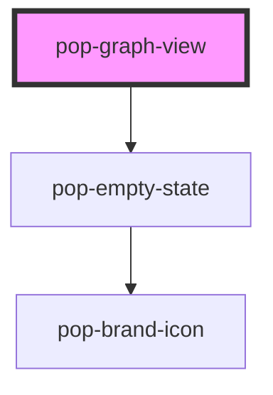

# pop-graph-view

<!-- Auto Generated Below -->

## Overview

pop-graph-view — the 2D force-directed knowledge graph.

LOCKED design (planned/notes-app-digital-brain/linking-and-graph.mdx):
  • Nodes = notes. Edges = `[[links]]` ONLY. Tags = colour / cluster (NEVER edges).
  • Node size = link-count (hubs are bigger).
  • 2D force-directed: d3-force simulation + CANVAS render (not SVG) + quadtree-free
    linear hit-testing (fine for the "hundreds → low-thousands" v1 target).
  • "Simplest that works" perf posture. Idle-pause: the sim ticks for a *capped*
    number of iterations, then stops — we never run rAF forever. A node drag or a
    `reheat()` restarts a short burst, then it settles again.
  • Reduced-motion: run the sim synchronously to convergence on load (no animation),
    then paint once. No ticking rAF at all.

Inputs are set as DOM **properties** (`nodes`, `edges`, `tagColors`).
Emits `nodeSelect({ id })` on click/tap and `nodeHover({ id | null })`.

The component owns its <canvas>; it manages its own resize observer, pointer
listeners and simulation, and tears all of them down on disconnect.

See planned/notes-app-digital-brain/components.mdx §pop-graph-view.

## Properties

| Property      | Attribute      | Description                                                             | Type          | Default |
| ------------- | -------------- | ----------------------------------------------------------------------- | ------------- | ------- |
| `edges`       | --             | `[[links]]` → edges (set as a property). source/target are note ids.    | `GraphEdge[]` | `[]`    |
| `filterTag`   | `filter-tag`   | Dim nodes whose tags don't include this tag ('' = no filter).           | `string`      | `''`    |
| `highlight`   | `highlight`    | Highlight nodes whose title matches this query ('' = none).             | `string`      | `''`    |
| `nodeCap`     | `node-cap`     | Cap node count (lower on mobile). 0 / undefined = no cap.               | `number`      | `0`     |
| `nodes`       | --             | Notes → nodes (set as a property).                                      | `GraphNode[]` | `[]`    |
| `orphansOnly` | `orphans-only` | Show only orphans (notes with no resolved links).                       | `boolean`     | `false` |
| `tagColors`   | --             | Stable tag → CSS colour map for node fill / legend (set as a property). | `string`      | `{}`    |

## Events

| Event        | Description                                                            | Type                           |
| ------------ | ---------------------------------------------------------------------- | ------------------------------ |
| `nodeHover`  | Fired on hover (id) / hover-out (null) → page can show a preview card. | `CustomEvent<{ id: string; }>` |
| `nodeSelect` | Fired on click / tap of a node → page navigates to /note/:id.          | `CustomEvent<{ id: string; }>` |

## Methods

### `reheat() => Promise<void>`

Public: re-run a short simulation burst (used by "re-layout" controls).

#### Returns

Type: `Promise<void>`

### `zoomToFit(padding?: number) => Promise<void>`

Public: fit + centre all nodes in the viewport.

#### Parameters

| Name      | Type     | Description |
| --------- | -------- | ----------- |
| `padding` | `number` |             |

#### Returns

Type: `Promise<void>`

## Dependencies

### Depends on

- [pop-empty-state](../../molecules/empty-state)

### Graph

----------------------------------------------

*Built with [StencilJS](https://stenciljs.com/)*
