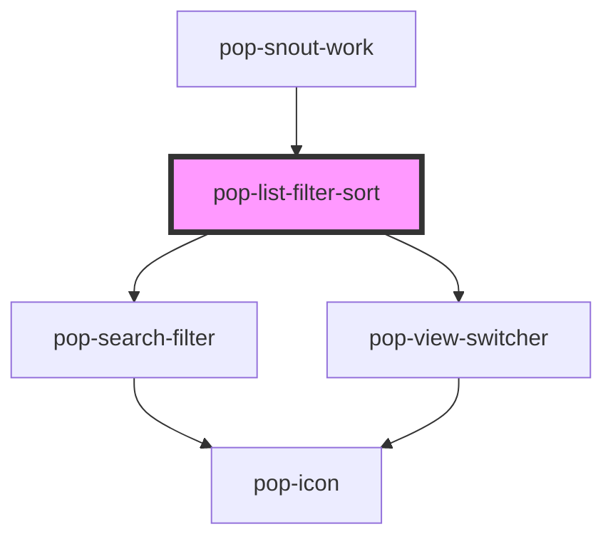

# pop-list-filter-sort

<!-- Auto Generated Below -->

## Overview

`pop-list-filter-sort` — the drop-in header row for list dialogs: ONE row
composing `pop-search-filter` (flex:1) + `pop-view-switcher` (flex:0) + a
named `actions` slot for dialog-specific extras (e.g. an Add button).

Many hub dialogs (photos/images, tasks, inventory, calendar) each hand-roll
this same search + filter + view toolbar; this organism is the shared piece.
Expected adopters: hub-inventory (done), hub-images/photos, hub-tasks.

Pass-through props: `value`, `placeholder`, `filters`, `debounce`,
`showClear` → pop-search-filter; `views`, `view` → pop-view-switcher.
`views` parsing to an EMPTY array (`views="[]"`) omits the switcher element
entirely (no stray flex-gap ghost). The `input` slot is passed through to
pop-search-filter: slot a host-owned search widget with `slot="input"` and
it replaces the built-in input (the host owns its value/events —
`searchChange` only fires from the built-in input). The pass-through slot is
always rendered (scoped-slot rule), so late-upgrading hosts still project.

The child events are re-emitted from THIS host (the originals are stopped),
so hosts listen in one place: `searchChange`, `filterChange`,
`clearFilters`, `viewChange`.

## Properties

| Property      | Attribute     | Description                                                            | Type      | Default             |
| ------------- | ------------- | ---------------------------------------------------------------------- | --------- | ------------------- |
| `debounce`    | `debounce`    | Debounce (ms) for searchChange (→ pop-search-filter).                  | `number`  | `150`               |
| `filters`     | `filters`     | JSON filter group descriptors (→ pop-search-filter `filters`).         | `string`  | `'[]'`              |
| `placeholder` | `placeholder` | Search placeholder (→ pop-search-filter).                              | `string`  | `'Search…'`         |
| `showClear`   | `show-clear`  | Show "Clear all" in the filter popover (→ pop-search-filter).          | `boolean` | `true`              |
| `value`       | `value`       | Current search text (→ pop-search-filter `value`).                     | `string`  | `''`                |
| `view`        | `view`        | Current view (→ pop-view-switcher `value`).                            | `string`  | `''`                |
| `views`       | `views`       | JSON view list (→ pop-view-switcher `views`). `[]` hides the switcher. | `string`  | `'["list","card"]'` |

## Events

| Event          | Description                                                | Type                                           |
| -------------- | ---------------------------------------------------------- | ---------------------------------------------- |
| `clearFilters` | Re-emitted from pop-search-filter: "Clear all" pressed.    | `CustomEvent<void>`                            |
| `filterChange` | Re-emitted from pop-search-filter: a filter group changed. | `CustomEvent<{ key: string; value: string; }>` |
| `searchChange` | Re-emitted from pop-search-filter: debounced search text.  | `CustomEvent<string>`                          |
| `viewChange`   | Re-emitted from pop-view-switcher: the view changed.       | `CustomEvent<string>`                          |

## Dependencies

### Used by

 - [pop-snout-work](../snout-work)

### Depends on

- [pop-search-filter](../../molecules/search-filter)
- [pop-view-switcher](../../molecules/view-switcher)

### Graph

----------------------------------------------

*Built with [StencilJS](https://stenciljs.com/)*
