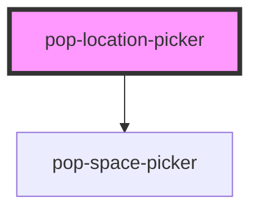

# pop-location-picker

<!-- Auto Generated Below -->

## Properties

| Property           | Attribute            | Description                                                            | Type      | Default  |
| ------------------ | -------------------- | ---------------------------------------------------------------------- | --------- | -------- |
| `allowCreateSpace` | `allow-create-space` | Whether the inline space picker shows its "+ New space" entry.         | `boolean` | `true`   |
| `spaceValue`       | `space-value`        | Picked room→space ids as JSON array (passthrough to pop-space-picker). | `string`  | `'[]'`   |
| `spaces`           | `spaces`             | Available spaces for the inline space picker (JSON array of LpSpace).  | `string`  | `'[]'`   |
| `value`            | `value`              | JSON of the current TaskLocation, or '' / 'null' for none.             | `string`  | `'null'` |

## Events

| Event                  | Description                                                              | Type                                                                                                            |
| ---------------------- | ------------------------------------------------------------------------ | --------------------------------------------------------------------------------------------------------------- |
| `locationChange`       | Emitted when the chosen location changes. Detail = TaskLocation \| null. | `CustomEvent<{ kind: "home"; } \| { kind: "place"; label: string; lat: number; lon: number; osmId?: string; }>` |
| `spaceCreateRequested` | Re-emitted from the inline space picker — host creates a Space.          | `CustomEvent<{ name: string; icon: string; room?: string; }>`                                                   |
| `spaceValueChanged`    | Re-emitted from the inline space picker — host persists `spaceIds`.      | `CustomEvent<string[]>`                                                                                         |

## Dependencies

### Depends on

- [pop-space-picker](../space-picker)

### Graph

----------------------------------------------

*Built with [StencilJS](https://stenciljs.com/)*
