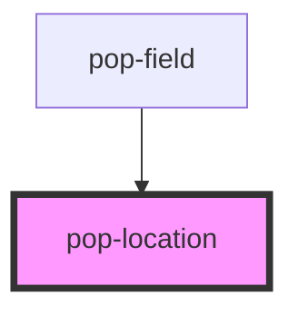

# pop-location

<!-- Auto Generated Below -->

## Overview

pop-location — a self-contained, reusable location picker.

Collapsed: ONE button showing the current place (pin + label) or "Set
Location". Tap → a popover with a single "ZIP or town" input that has a
find-my-location icon on its right edge, OpenStreetMap (Photon) autocomplete
suggestions under it, and a GPS→reverse-geocode (Nominatim) / IP (ipapi)
fallback on the icon. Selecting a suggestion or geolocating resolves
{ label, zip, lat, lng }, persists it to the SHARED `hub:location`
localStorage key (so every instance stays in sync), and emits
`popLocationChange`.

## Properties

| Property       | Attribute       | Description                                                                                                                                                                                                                                                                                                                                                                                      | Type                   | Default                                         |
| -------------- | --------------- | ------------------------------------------------------------------------------------------------------------------------------------------------------------------------------------------------------------------------------------------------------------------------------------------------------------------------------------------------------------------------------------------------ | ---------------------- | ----------------------------------------------- |
| `default`      | `default`       | Soft fallback location (label or ZIP) shown when NOTHING is in the shared `hub:location` store. It is display-only: it is NOT written to localStorage and does NOT emit `popLocationChange`, so the user can still actively set a real location (which then wins + persists) and we never clobber a server zip. Precedence for what's shown: stored `hub:location` → `default` → "Set Location". | `string`               | `''`                                            |
| `ipUrl`        | `ip-url`        | IP-geolocation fallback endpoint.                                                                                                                                                                                                                                                                                                                                                                | `string`               | `'https://ipapi.co/json/'`                      |
| `nominatimUrl` | `nominatim-url` | Nominatim reverse-geocode endpoint (for GPS coords → place).                                                                                                                                                                                                                                                                                                                                     | `string`               | `'https://nominatim.openstreetmap.org/reverse'` |
| `photonUrl`    | `photon-url`    | Photon autocomplete endpoint (overridable; OSM-data, keyless, CORS-ok).                                                                                                                                                                                                                                                                                                                          | `string`               | `'https://photon.komoot.io/api/'`               |
| `value`        | `value`         | Initial location label (optional — the shared store wins if present).                                                                                                                                                                                                                                                                                                                            | `string`               | `''`                                            |
| `variant`      | `variant`       | Trigger style:  - 'button' (default): a filled button (pin + label + caret).  - 'inline': plain inline text (label + subtle ▾ chevron), styled to sit    INSIDE another element (e.g. a card's location label). The popover still    anchors to + drops down from this trigger, but right-aligns so it never    overflows off the right edge on mobile.                                          | `"button" \| "inline"` | `'button'`                                      |

## Events

| Event               | Description                                                                    | Type                            |
| ------------------- | ------------------------------------------------------------------------------ | ------------------------------- |
| `popLocationChange` | Fired on every set with the resolved place; consumers may persist server-side. | `CustomEvent<ResolvedLocation>` |

## Dependencies

### Used by

 - [pop-field](../../molecules/field)

### Graph

----------------------------------------------

*Built with [StencilJS](https://stenciljs.com/)*
