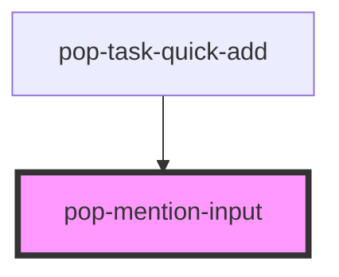

# pop-mention-input

<!-- Auto Generated Below -->

## Properties

| Property            | Attribute             | Description                                                              | Type              | Default     |
| ------------------- | --------------------- | ------------------------------------------------------------------------ | ----------------- | ----------- |
| `initialValue`      | --                    | Optional controlled initial value.                                       | `MentionValue`    | `undefined` |
| `placeholder`       | `placeholder`         |                                                                          | `string`          | `''`        |
| `sources`           | --                    | Mention sources. Passed as a property; do not stringify.                 | `MentionSource[]` | `[]`        |
| `submitButtonLabel` | `submit-button-label` | Label for the submit button. Default is the ➕ emoji.                     | `string`          | `'➕'`       |
| `submitDisabled`    | `submit-disabled`     | If true, the [➕] submit button is disabled regardless of internal state. | `boolean`         | `false`     |

## Events

| Event          | Description                                          | Type                                                  |
| -------------- | ---------------------------------------------------- | ----------------------------------------------------- |
| `mentionAdded` | Emitted when a mention is accepted from the popover. | `CustomEvent<{ source: string; item: MentionItem; }>` |
| `submitted`    | Emitted when user submits (Enter or click on ➕).     | `CustomEvent<MentionValue>`                           |
| `valueChanged` | Emitted whenever text or mentions change.            | `CustomEvent<MentionValue>`                           |

## Methods

### `clear() => Promise<void>`

Imperatively clear the input (used after submit).

#### Returns

Type: `Promise<void>`

### `focusInput() => Promise<void>`

Imperatively focus the input.

#### Returns

Type: `Promise<void>`

### `getValue() => Promise<MentionValue>`

Imperatively read current value.

#### Returns

Type: `Promise<MentionValue>`

## Dependencies

### Used by

 - [pop-task-quick-add](../task-quick-add)

### Graph

----------------------------------------------

*Built with [StencilJS](https://stenciljs.com/)*
