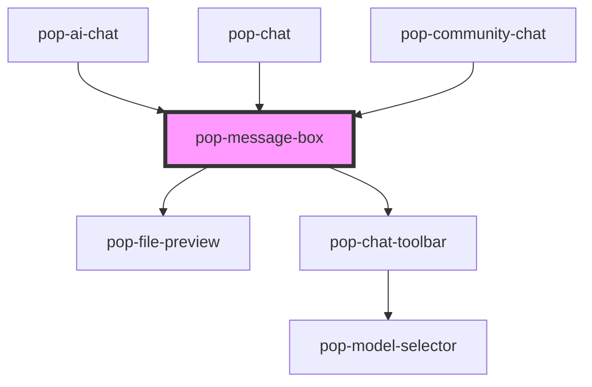

# pop-message-box

<!-- Auto Generated Below -->

## Properties

| Property        | Attribute         | Description | Type      | Default     |
| --------------- | ----------------- | ----------- | --------- | ----------- |
| `activeTools`   | `active-tools`    |             | `string`  | `'[]'`      |
| `disabled`      | `disabled`        |             | `boolean` | `false`     |
| `models`        | `models`          |             | `string`  | `'[]'`      |
| `placeholder`   | `placeholder`     |             | `string`  | `'Message'` |
| `selectedMode`  | `selected-mode`   |             | `string`  | `'chat'`    |
| `selectedModel` | `selected-model`  |             | `string`  | `''`        |
| `showMicButton` | `show-mic-button` |             | `boolean` | `false`     |
| `tools`         | `tools`           |             | `string`  | `'[]'`      |
| `value`         | `value`           |             | `string`  | `''`        |

## Events

| Event             | Description                      | Type                                             |
| ----------------- | -------------------------------- | ------------------------------------------------ |
| `popModeChanged`  |                                  | `CustomEvent<string>`                            |
| `popModelChanged` |                                  | `CustomEvent<string>`                            |
| `popToolToggled`  |                                  | `CustomEvent<{ id: string; enabled: boolean; }>` |
| `send`            | Emitted when the message is sent | `CustomEvent<{ text: string; files: File[]; }>`  |
| `valueChange`     |                                  | `CustomEvent<string>`                            |

## Methods

### `clear() => Promise<void>`

#### Returns

Type: `Promise<void>`

### `setFocus() => Promise<void>`

#### Returns

Type: `Promise<void>`

### `setInputValue(text: string) => Promise<void>`

#### Parameters

| Name   | Type     | Description |
| ------ | -------- | ----------- |
| `text` | `string` |             |

#### Returns

Type: `Promise<void>`

## Dependencies

### Used by

 - [pop-ai-chat](../ai-chat)
 - [pop-chat](../chat)
 - [pop-community-chat](../community-chat)

### Depends on

- [pop-file-preview](../../molecules/file-preview)
- [pop-chat-toolbar](../chat-toolbar)

### Graph

----------------------------------------------

*Built with [StencilJS](https://stenciljs.com/)*
