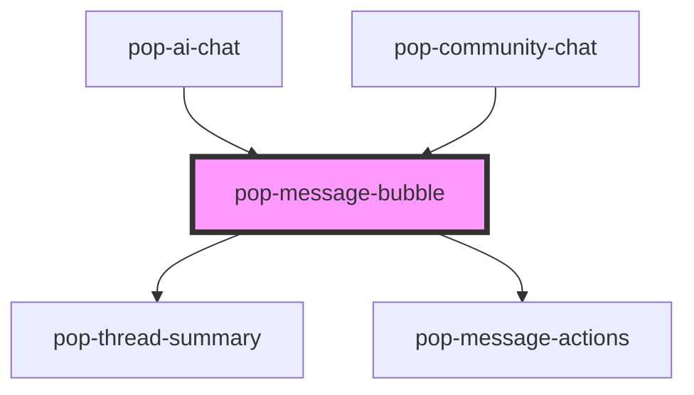

# pop-message-bubble

<!-- Auto Generated Below -->

## Properties

| Property          | Attribute           | Description                                                                                        | Type                                | Default    |
| ----------------- | ------------------- | -------------------------------------------------------------------------------------------------- | ----------------------------------- | ---------- |
| `avatarInitials`  | `avatar-initials`   | Fallback initials when no avatarUrl                                                                | `string`                            | `''`       |
| `avatarUrl`       | `avatar-url`        | Avatar image URL                                                                                   | `string`                            | `''`       |
| `content`         | `content`           | Markdown content (plain text for member role)                                                      | `string`                            | `''`       |
| `intents`         | `intents`           | JSON string of IntentChip[] shown on assistant messages after streaming                            | `string`                            | `'[]'`     |
| `isAdmin`         | `is-admin`          | Admin can delete any message                                                                       | `boolean`                           | `false`    |
| `isOwn`           | `is-own`            | Align bubble to the right (current user's own messages)                                            | `boolean`                           | `false`    |
| `isThread`        | `is-thread`         | When true, thread action is hidden (already inside a thread)                                       | `boolean`                           | `false`    |
| `layout`          | `layout`            | bubble = rounded chat bubbles, prose = full-width document blocks                                  | `"bubble" \| "prose"`               | `'bubble'` |
| `messageId`       | `message-id`        | Passed back in edit/delete events                                                                  | `string`                            | `''`       |
| `role`            | `role`              | Role determines layout: user = right bubble, assistant = left prose/bubble, member = Discord-style | `"assistant" \| "member" \| "user"` | `'member'` |
| `showCopyButton`  | `show-copy-button`  | Show copy-to-clipboard button on AI messages                                                       | `boolean`                           | `false`    |
| `streaming`       | `streaming`         | Whether the message is still streaming in                                                          | `boolean`                           | `false`    |
| `streamingMode`   | `streaming-mode`    | inline = content builds token by token; dots = animated ellipsis while waiting                     | `"dots" \| "inline"`                | `'inline'` |
| `threadAvatarUrl` | `thread-avatar-url` | Last reply author avatar                                                                           | `string`                            | `''`       |
| `threadCount`     | `thread-count`      | Thread reply count (member role)                                                                   | `number`                            | `0`        |
| `threadLastAt`    | `thread-last-at`    | Last reply timestamp                                                                               | `number`                            | `0`        |
| `threadPreview`   | `thread-preview`    | Last reply preview text                                                                            | `string`                            | `''`       |
| `timestamp`       | `timestamp`         | Unix ms timestamp                                                                                  | `number`                            | `0`        |
| `userName`        | `user-name`         | Display name shown in header                                                                       | `string`                            | `''`       |

## Events

| Event               | Description | Type                                         |
| ------------------- | ----------- | -------------------------------------------- |
| `popCopied`         |             | `CustomEvent<void>`                          |
| `popMessageDeleted` |             | `CustomEvent<string>`                        |
| `popMessageEdited`  |             | `CustomEvent<{ id: string; text: string; }>` |
| `popThreadOpened`   |             | `CustomEvent<any>`                           |

## Dependencies

### Used by

 - [pop-ai-chat](../ai-chat)
 - [pop-community-chat](../community-chat)

### Depends on

- [pop-thread-summary](../../molecules/thread-summary)
- [pop-message-actions](../../molecules/message-actions)

### Graph

----------------------------------------------

*Built with [StencilJS](https://stenciljs.com/)*
