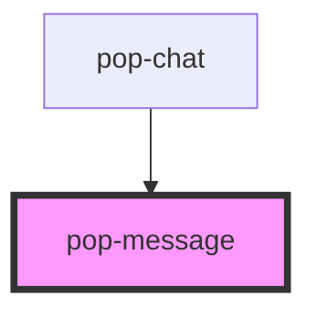

# pop-message

<!-- Auto Generated Below -->

## Properties

| Property        | Attribute         | Description                                                                                    | Type      | Default |
| --------------- | ----------------- | ---------------------------------------------------------------------------------------------- | --------- | ------- |
| `currentUserId` | `current-user-id` | The current user's ID                                                                          | `string`  | `''`    |
| `isAdmin`       | `is-admin`        | Whether the current user has admin privileges (allows deleting any message)                    | `boolean` | `false` |
| `isThread`      | `is-thread`       | Whether this message is displayed inside a thread view (hides thread actions, changes context) | `boolean` | `false` |
| `message`       | `message`         | The message object (serialized or object)                                                      | `any`     | `{}`    |

## Events

| Event               | Description                                | Type                                         |
| ------------------- | ------------------------------------------ | -------------------------------------------- |
| `popMessageDeleted` | Emitted when a message is deleted          | `CustomEvent<string>`                        |
| `popMessageEdited`  | Emitted when a message is edited           | `CustomEvent<{ id: string; text: string; }>` |
| `popThreadOpened`   | Emitted when a user wants to open a thread | `CustomEvent<any>`                           |

## Dependencies

### Used by

 - [pop-chat](../chat)

### Graph

----------------------------------------------

*Built with [StencilJS](https://stenciljs.com/)*
