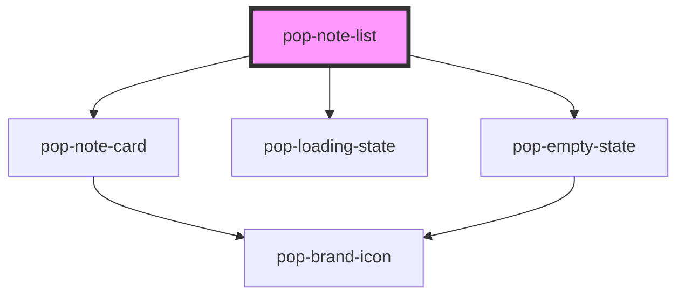

# pop-note-list

<!-- Auto Generated Below -->

## Overview

pop-note-list — renders a collection of pop-note-card.

Two view modes (both ship in v1): a single-column **list** and a gallery
**grid**. The default Home layout splits notes into a **Pinned** section and a
**Recent** section (`sectioned`); other surfaces (Trash, a filtered facet)
render one flat section by setting `sectioned={false}`.

`notes` is set as a DOM **property**. Snippets are supplied via a `snippets`
map (noteId → excerpt) because note bodies live in separate `/blocks` docs.

States: `loading` (skeleton), empty (slotted `empty` content or a default
pop-empty-state), and populated.

See planned/notes-app-digital-brain/components.mdx §pop-note-list.

## Properties

| Property     | Attribute     | Description                                                          | Type               | Default  |
| ------------ | ------------- | -------------------------------------------------------------------- | ------------------ | -------- |
| `loading`    | `loading`     | Show the loading skeleton instead of content.                        | `boolean`          | `false`  |
| `notes`      | --            | The notes to render (set as a property).                             | `NoteCardData[]`   | `[]`     |
| `sectioned`  | `sectioned`   | Split into Pinned + Recent sections (Home default) vs one flat list. | `boolean`          | `true`   |
| `selectedId` | `selected-id` | id of the currently-selected note (highlights its card).             | `string`           | `''`     |
| `snippets`   | --            | noteId → snippet/excerpt text (set as a property).                   | `string`           | `{}`     |
| `view`       | `view`        | List (rows) or grid (gallery tiles).                                 | `"grid" \| "list"` | `'list'` |

## Events

| Event        | Description                                                  | Type                                            |
| ------------ | ------------------------------------------------------------ | ----------------------------------------------- |
| `notePin`    |                                                              | `CustomEvent<{ id: string; pinned: boolean; }>` |
| `noteSelect` | Re-emitted from the cards so the page can open / pin a note. | `CustomEvent<{ id: string; }>`                  |

## Dependencies

### Depends on

- [pop-note-card](../../molecules/note-card)
- [pop-loading-state](../../molecules/loading-state)
- [pop-empty-state](../../molecules/empty-state)

### Graph

----------------------------------------------

*Built with [StencilJS](https://stenciljs.com/)*
