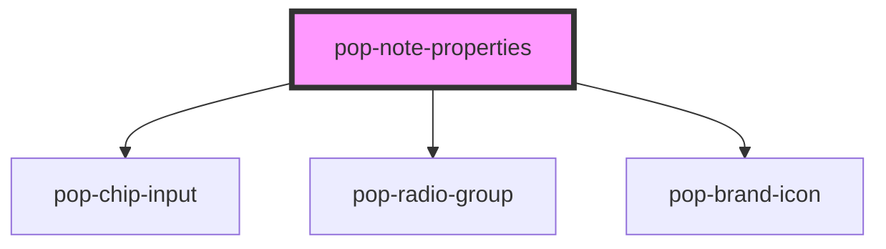

# pop-note-properties

<!-- Auto Generated Below -->

## Properties

| Property         | Attribute         | Description                                                          | Type                                           | Default     |
| ---------------- | ----------------- | -------------------------------------------------------------------- | ---------------------------------------------- | ----------- |
| `aiHint`         | `ai-hint`         | AI-backfill hint surfaced subtly (e.g. "Indexing…" / "Indexed").     | `string`                                       | `''`        |
| `backlinksCount` | `backlinks-count` | Backlinks count for the collapsible section header (body is a slot). | `number`                                       | `0`         |
| `created`        | `created`         | Pre-formatted created timestamp (host formats; rail just displays).  | `string`                                       | `''`        |
| `linkedTasks`    | --                | Tasks this note backs — deep-link out to tasks.popcorn245.com.       | `LinkedTaskRef[]`                              | `[]`        |
| `linksOut`       | `links-out`       | Count of `[[ ]]` link-outs (Phase 3 populates note.links).           | `number`                                       | `0`         |
| `noteTitle`      | `note-title`      | Editable title — mirrors the note's derived/first-line title.        | `string`                                       | `''`        |
| `pinned`         | `pinned`          | Pinned to the top of Home's Pinned split.                            | `boolean`                                      | `false`     |
| `suggestions`    | --                | Autocomplete seed for the tag input (all tags across the brain).     | `TagSuggestion[]`                              | `[]`        |
| `syncState`      | `sync-state`      | Sync chip state.                                                     | `"error" \| "pending" \| "saving" \| "synced"` | `'synced'`  |
| `tags`           | --                | Tags-as-properties.                                                  | `string[]`                                     | `[]`        |
| `updated`        | `updated`         | Pre-formatted updated timestamp.                                     | `string`                                       | `''`        |
| `visibility`     | `visibility`      | Visibility — reuses the task enum.                                   | `string`                                       | `'private'` |

## Events

| Event                  | Description                                                    | Type                    |
| ---------------------- | -------------------------------------------------------------- | ----------------------- |
| `noteVisibilityChange` | Emitted on visibility select.                                  | `CustomEvent<string>`   |
| `openTask`             | Emitted when a linked task is opened (deep-link to tasks app). | `CustomEvent<string>`   |
| `pinnedChange`         | Emitted on pin toggle.                                         | `CustomEvent<boolean>`  |
| `tagsChange`           | Emitted whenever the tag set changes.                          | `CustomEvent<string[]>` |
| `titleChange`          | Emitted on title commit (blur / Enter).                        | `CustomEvent<string>`   |

## Dependencies

### Depends on

- [pop-chip-input](../../molecules/chip-input)
- [pop-radio-group](../../molecules/radio-group)
- [pop-brand-icon](../../atoms/brand-icon)

### Graph

----------------------------------------------

*Built with [StencilJS](https://stenciljs.com/)*
