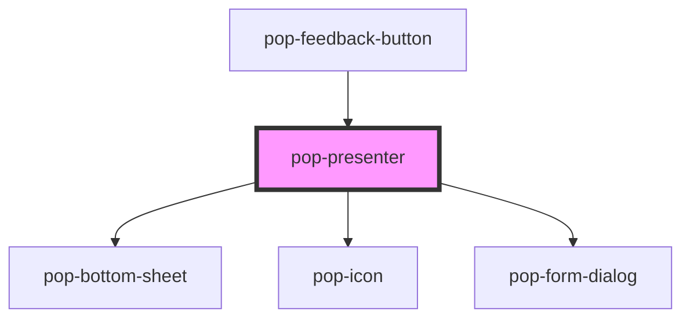

# pop-presenter

<!-- Auto Generated Below -->

## Overview

pop-presenter — the generic presentation-tier resolver (organism).

One surface (form fields / panel body / anything slotted) presented as:
  • sheet  (viewport < 768)      → renders `pop-bottom-sheet` itself
  • dialog (768 … dockMin-1)     → renders `pop-form-dialog` itself
  • dock   (viewport ≥ 1200)     → renders a PLAIN panel container that the
                                   HOST places in its layout ("controlled
                                   tier + slot": dock pushes layout, it is
                                   not an overlay — placement is host work)

The host learns the resolved tier via `tierChange` (emitted on open and on
every resize across a breakpoint while open; content is re-slotted, not
lost). Dock-collapse preference/persistence is the HOST's job — to keep a
collapsed dock, force `tier="dialog"`; the dialog then shows a "Dock to
side" affordance (viewport permitting) which emits `popRedock` so the host
can flip its preference back.

Slots:
  (default) — the surface content
  header    — rich header content (title + bespoke right-side control, e.g. a
              list select or room switcher). Rendered inline with the ×/dock
              buttons in dialog + dock tiers, and at the top of the sheet
              body. Omit to use the plain `heading` chrome instead.
  actions   — footer, typically a `pop-actions-footer` (rendered by the
              sheet's actions area / below the dialog body / dock footer).
              Submission is driven by the footer's own events — the dialog
              tier renders footer-less (`hideFooter`), so a stray implicit
              submit can never fire.

## Properties

| Property   | Attribute   | Description                                                                                                                       | Type                            | Default                          |
| ---------- | ----------- | --------------------------------------------------------------------------------------------------------------------------------- | ------------------------------- | -------------------------------- |
| `dockMin`  | `dock-min`  |                                                                                                                                   | `1200`                          | `PRESENTER_BREAKPOINTS.dockMin`  |
| `heading`  | `heading`   | Chrome heading (sheet title / dialog title / dock header). Omit when the slotted surface renders its own header.                  | `string`                        | `undefined`                      |
| `open`     | `open`      | Visibility — when false the presenter renders nothing (parent owns state).                                                        | `boolean`                       | `false`                          |
| `sheetMax` | `sheet-max` | Breakpoint overrides. Defaults restore the quick-controls spec values.                                                            | `767`                           | `PRESENTER_BREAKPOINTS.sheetMax` |
| `tier`     | `tier`      | Force a tier regardless of viewport (host-controlled mode — e.g. the host keeps a collapsed-dock preference by forcing 'dialog'). | `"dialog" \| "dock" \| "sheet"` | `undefined`                      |

## Events

| Event        | Description                                                                                              | Type                                         |
| ------------ | -------------------------------------------------------------------------------------------------------- | -------------------------------------------- |
| `popClose`   | × / backdrop / Esc / dock close.                                                                         | `CustomEvent<void>`                          |
| `popRedock`  | The dialog tier's "Dock to side" affordance was tapped (host flips its dock preference and re-presents). | `CustomEvent<void>`                          |
| `tierChange` | The resolved tier, emitted on open and whenever it changes while open.                                   | `CustomEvent<"dialog" \| "dock" \| "sheet">` |

## Dependencies

### Used by

 - [pop-feedback-button](../feedback-button)

### Depends on

- [pop-bottom-sheet](../../molecules/bottom-sheet)
- [pop-icon](../../atoms/icon)
- [pop-form-dialog](../../molecules/form-dialog)

### Graph

----------------------------------------------

*Built with [StencilJS](https://stenciljs.com/)*
