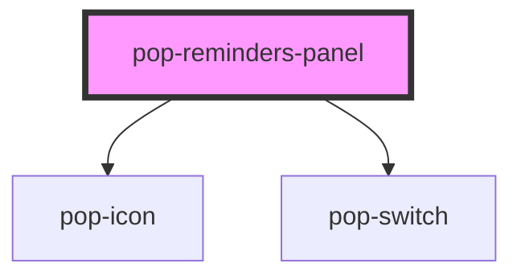

# pop-reminders-panel

<!-- Auto Generated Below -->

## Overview

pop-reminders-panel — the Reminders panel (organism), migrated from the hub's
700-line hub-reminders monolith. PRESENTATION-ONLY: the host (Bucket Hub's
hub-reminders wrapper) owns the network (PanelShell + PanelData), optimistic
mutations, clock-skew-safe deadline math, and the alarm engine (Web-Audio +
HTMLAudio tone, vibration, push pref). This component displays what it is
handed and emits `pop*` events for every action the host must perform.

Shared VISUAL LANGUAGE (matches the approved mockup): a red→amber→blue "drain"
gradient that empties RIGHT→LEFT — the countdown hero bar here, the hub tile
face, and the collapsed chip all reuse it. The last sliver standing is red
(urgent). Themed via ui-kit tokens (--ink/--ink-muted/--line/--surface-card/
--surface-raised/--brand-blue) with fallbacks; mobile-first (390px sheet).

Object/array props accept a value (property binding) OR a JSON string
(attribute — how Storybook / plain HTML pass them), parsed defensively.

Events (all composed + bubbling):
  popCreate {title,time}       — quick-create submitted
  popSnooze {id,minutes}       — per-row / banner snooze
  popDismiss {id}              — per-row / banner dismiss (complete)
  popEditReminder {id,title,time} — inline edit saved
  popDelete {id}               — per-row delete
  popFilterChange {filter}     — segmented filter changed
  popSearchChange {search}     — search text changed (debounce is the host's)
  popAlarmChange {patch,preview}— an alarm setting changed (host persists +
                                  previews the tone when preview=true)
  popAlarmTest                 — the Test button (host plays the tone)
  popStopRing                  — silence a no-id ringing banner
  popCountdownDone             — the hero countdown crossed zero
  popRefresh / popClose        — header refresh / close (standalone mode)
  popUnlock                    — a user gesture in the panel (host unlocks audio)

## Properties

| Property            | Attribute            | Description                                                                                                                                            | Type                                       | Default                                               |
| ------------------- | -------------------- | ------------------------------------------------------------------------------------------------------------------------------------------------------ | ------------------------------------------ | ----------------------------------------------------- |
| `alarm`             | `alarm`              | Alarm settings for the drawer (object OR JSON string).                                                                                                 | `AlarmSettingsView \| string`              | `DEFAULT_ALARM_SETTINGS`                              |
| `countdownDeadline` | `countdown-deadline` | Local-clock deadline (epoch ms) of the next reminder — the hero countdown target. Host derives it skew-safe (syncedAt + fireInMs). 0/undefined = idle. | `number`                                   | `0`                                                   |
| `counts`            | `counts`             | Inline segmented-filter counts (object OR JSON string). Optional.                                                                                      | `ReminderFilterCounts \| string`           | `{ upcoming: 0, today: 0, overdue: 0, recurring: 0 }` |
| `error`             | `error`              | An error line shown in place of the list (with a Retry → popRefresh).                                                                                  | `string`                                   | `''`                                                  |
| `filter`            | `filter`             | Active filter id.                                                                                                                                      | `string`                                   | `'upcoming'`                                          |
| `heroTotalMs`       | `hero-total-ms`      | The original set→fire window (ms) — the drain denominator. Optional.                                                                                   | `number`                                   | `0`                                                   |
| `loading`           | `loading`            | First-load (no data yet) → a subtle loader instead of the empty state.                                                                                 | `boolean`                                  | `false`                                               |
| `nextTitle`         | `next-title`         | The next reminder's title (hero "Next reminder" name).                                                                                                 | `string`                                   | `''`                                                  |
| `reminders`         | `reminders`          | The rows for the ACTIVE filter/search view (object array OR JSON string).                                                                              | `ReminderRow[] \| string`                  | `[]`                                                  |
| `ringing`           | `ringing`            | The reminder currently RINGING (host's alarm engine is looping the tone), or null. Drives the ringing banner + the row pulse. (object OR JSON string)  | `string \| { id: string; title: string; }` | `null`                                                |
| `searchText`        | `search-text`        | Search text (controlled by the host).                                                                                                                  | `string`                                   | `''`                                                  |
| `showHeader`        | `show-header`        | Render the panel's own header (title + refresh + close). Hosts with their own chrome (the hub's PanelShell) set this false — only the ⚙ gear shows.    | `boolean`                                  | `true`                                                |
| `sounds`            | `sounds`             | Selectable alarm tones (object array OR JSON string).                                                                                                  | `AlarmSoundOption[] \| string`             | `DEFAULT_ALARM_SOUNDS`                                |

## Events

| Event              | Description | Type                                                                    |
| ------------------ | ----------- | ----------------------------------------------------------------------- |
| `popAlarmChange`   |             | `CustomEvent<{ patch: Partial<AlarmSettingsView>; preview: boolean; }>` |
| `popAlarmTest`     |             | `CustomEvent<void>`                                                     |
| `popClose`         |             | `CustomEvent<void>`                                                     |
| `popCountdownDone` |             | `CustomEvent<void>`                                                     |
| `popCreate`        |             | `CustomEvent<{ title: string; time: string; }>`                         |
| `popDelete`        |             | `CustomEvent<{ id: string; }>`                                          |
| `popDismiss`       |             | `CustomEvent<{ id: string; }>`                                          |
| `popEditReminder`  |             | `CustomEvent<{ id: string; title: string; time: string; }>`             |
| `popFilterChange`  |             | `CustomEvent<{ filter: string; }>`                                      |
| `popRefresh`       |             | `CustomEvent<void>`                                                     |
| `popSearchChange`  |             | `CustomEvent<{ search: string; }>`                                      |
| `popSnooze`        |             | `CustomEvent<{ id: string; minutes: number; }>`                         |
| `popStopRing`      |             | `CustomEvent<void>`                                                     |
| `popUnlock`        |             | `CustomEvent<void>`                                                     |

## Dependencies

### Depends on

- [pop-icon](../../atoms/icon)
- [pop-switch](../../atoms/switch)

### Graph

----------------------------------------------

*Built with [StencilJS](https://stenciljs.com/)*
