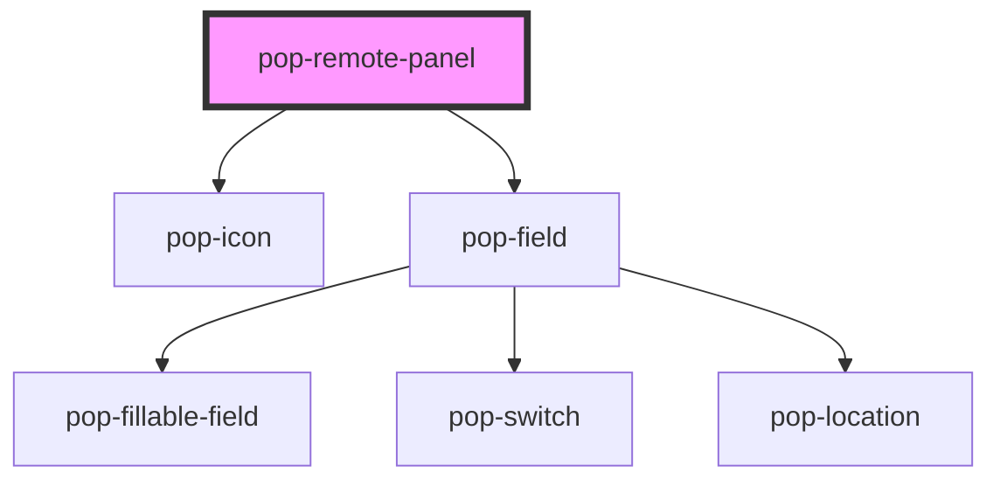

# pop-remote-panel

<!-- Auto Generated Below -->

## Overview

pop-remote-panel — the unified AV control surface (organism).

Presentation-only sibling of the Bucket Hub's `hub-remote`: it renders the
room switcher, the Harmony status line + activities + volume, and the Shield
transport row + app launcher, and emits `pop*` events. The HOST owns the
network (hubApi), optimistic mutations and the PanelShell chrome — this
component just displays the data it is handed.

Two capability sets, each SECTION gated by its own flag:
  • Harmony (`harmonyEnabled`) — activities · volume · room switcher · status.
  • Shield transport (`transportEnabled`) — playback row · app launcher.

Object props (`activities`, `current`, `rooms`) accept an object (property
binding) OR a JSON string (attribute — how Storybook / plain HTML pass them),
parsed defensively.

── Three approved UX behaviors (honest to the IR-relative hardware) ──────────
  1. Volume SLIDER + hold-to-repeat. The Harmony receiver is IR-RELATIVE (step
     up/down only — no absolute-set API), so the slider is a visual level that
     emits `popVolumeStep` as it crosses each unit; the ± buttons press-and-hold
     to repeat (~90ms after a 300ms delay). `current.level` drives the readout.
  2. Mute reflects the `muted` prop (amber treatment + dimmed level). There is
     NO server truth for mute (the toggle returns no state) — the host owns
     `muted` as an optimistic local toggle.
  3. Play/pause reflects `playState` (derived by the host from the primary
     room's device state); the center transport button is emphasized + shows
     ▶ vs ⏸. 'unknown' → the host keeps the toggle optimistic.

## Properties

| Property            | Attribute             | Description                                                                            | Type                                              | Default                      |
| ------------------- | --------------------- | -------------------------------------------------------------------------------------- | ------------------------------------------------- | ---------------------------- |
| `activities`        | `activities`          | Harmony activities (object OR JSON string).                                            | `RemoteActivity[] \| string`                      | `[]`                         |
| `appAssetBase`      | `app-asset-base`      | Base path the app-logo SVGs are served from (host copies them into www/).              | `string`                                          | `'/assets/apps'`             |
| `calibrateMax`      | `calibrate-max`       |                                                                                        | `number`                                          | `REMOTE_CALIBRATE_MAX`       |
| `calibrateMin`      | `calibrate-min`       | Receiver volume bounds — mirror the host's REMOTE_CALIBRATE_*.                         | `number`                                          | `REMOTE_CALIBRATE_MIN`       |
| `current`           | `current`             | Current AV snapshot: active activity + tracked receiver level (object OR JSON string). | `RemoteCurrent \| string`                         | `{ level: 0, known: false }` |
| `degraded`          | `degraded`            | Harmony degraded (hub unreachable, default controls shown).                            | `boolean`                                         | `false`                      |
| `error`             | `error`               | A blocking error message (e.g. "Could not reach the Remote.").                         | `string`                                          | `''`                         |
| `harmonyEnabled`    | `harmony-enabled`     | Whether the Harmony sections (activities · volume · switcher · status) show.           | `boolean`                                         | `false`                      |
| `loading`           | `loading`             | Loading (initial Harmony fetch) — a subtle inline spinner.                             | `boolean`                                         | `false`                      |
| `muted`             | `muted`               | Mute state — optimistic local toggle owned by the host (no server truth).              | `boolean`                                         | `false`                      |
| `nowPlaying`        | `now-playing`         | The active primary-room "what's playing" app name (e.g. "Netflix"), or ''.             | `string`                                          | `''`                         |
| `pendingActivityId` | `pending-activity-id` | The activity id the host optimistically marked pending (spinner). '' = none.           | `string`                                          | `''`                         |
| `playState`         | `play-state`          | Derived transport state driving the emphasized play/pause button.                      | `"paused" \| "playing" \| "stopped" \| "unknown"` | `'unknown'`                  |
| `rooms`             | `rooms`               | The /av rooms for the switcher (object OR JSON string).                                | `RemoteRoom[] \| string`                          | `[]`                         |
| `selectedArea`      | `selected-area`       | The selected room's area, or null → default to the primary (Harmony) room.             | `string`                                          | `null`                       |
| `statusNote`        | `status-note`         | A transient status note ("Starting Watch TV…").                                        | `string`                                          | `''`                         |
| `transportEnabled`  | `transport-enabled`   | Whether the Shield transport sections (playback · apps) show.                          | `boolean`                                         | `false`                      |

## Events

| Event              | Description                                                                                       | Type                                                                                                    |
| ------------------ | ------------------------------------------------------------------------------------------------- | ------------------------------------------------------------------------------------------------------- |
| `popActivityStart` | Fires when an activity card is tapped (activity id).                                              | `CustomEvent<string>`                                                                                   |
| `popAppLaunch`     | Fires when a streaming-app tile is tapped (app key).                                              | `CustomEvent<string>`                                                                                   |
| `popCalibrate`     | Fires with the clamped level when the calibrate form is submitted.                                | `CustomEvent<number>`                                                                                   |
| `popClose`         | Fires when the panel requests to close (host chrome usually owns ×; provided for standalone use). | `CustomEvent<void>`                                                                                     |
| `popMuteToggle`    | Fires when the mute button is tapped (host toggles optimistic `muted`).                           | `CustomEvent<void>`                                                                                     |
| `popPowerOff`      | Fires when the red power button is tapped.                                                        | `CustomEvent<void>`                                                                                     |
| `popRetry`         | Fires when the error-banner Retry is tapped.                                                      | `CustomEvent<void>`                                                                                     |
| `popRoomChange`    | Fires when a different room is picked (area).                                                     | `CustomEvent<string>`                                                                                   |
| `popTransport`     | Fires when a transport button is tapped (the action; center = 'toggle').                          | `CustomEvent<"forward" \| "next" \| "pause" \| "play" \| "previous" \| "rewind" \| "stop" \| "toggle">` |
| `popVolumeStep`    | Fires for EACH IR volume step (slider crossing a unit, or a ± press/hold).                        | `CustomEvent<{ dir: "up" \| "down"; }>`                                                                 |

## Dependencies

### Depends on

- [pop-icon](../../atoms/icon)
- [pop-field](../../molecules/field)

### Graph

----------------------------------------------

*Built with [StencilJS](https://stenciljs.com/)*
