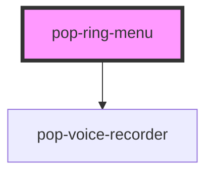

# pop-ring-menu

<!-- Auto Generated Below -->

## Properties

| Property        | Attribute         | Description                                    | Type      | Default |
| --------------- | ----------------- | ---------------------------------------------- | --------- | ------- |
| `centerIconSvg` | `center-icon-svg` | SVG string for the center button icon          | `string`  | `''`    |
| `items`         | `items`           | JSON string of RingMenuItem array              | `string`  | `'[]'`  |
| `showMic`       | `show-mic`        | Show a mic zone below the ring for voice memos | `boolean` | `false` |

## Events

| Event                  | Description                             | Type                  |
| ---------------------- | --------------------------------------- | --------------------- |
| `actionSelected`       | Emitted when an action is selected      | `CustomEvent<string>` |
| `micRecordingCancel`   | Emitted when mic recording is cancelled | `CustomEvent<void>`   |
| `micRecordingComplete` | Emitted when mic recording is saved     | `CustomEvent<Blob>`   |

## Dependencies

### Depends on

- [pop-voice-recorder](../voice-recorder)

### Graph

----------------------------------------------

*Built with [StencilJS](https://stenciljs.com/)*
