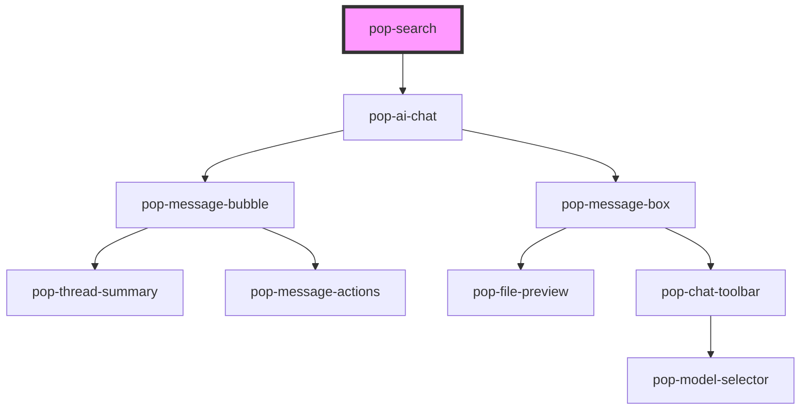

# pop-search

<!-- Auto Generated Below -->

## Properties

| Property            | Attribute             | Description                                                                                                            | Type                     | Default                |
| ------------------- | --------------------- | ---------------------------------------------------------------------------------------------------------------------- | ------------------------ | ---------------------- |
| `activeTools`       | `active-tools`        |                                                                                                                        | `string`                 | `'[]'`                 |
| `chatPanelWidth`    | `chat-panel-width`    | Width of the AI chat side panel in px — mobile always overrides to full-screen                                         | `number`                 | `480`                  |
| `endpoint`          | `endpoint`            | POST endpoint for SSE chat — enables the AI chat side panel                                                            | `string`                 | `''`                   |
| `filters`           | `filters`             | JSON array of filter definitions: { key: string, label: string, options: {value, label}[] }                            | `string`                 | `'[]'`                 |
| `loading`           | `loading`             |                                                                                                                        | `boolean`                | `false`                |
| `models`            | `models`              |                                                                                                                        | `string`                 | `'[]'`                 |
| `placeholder`       | `placeholder`         |                                                                                                                        | `string`                 | `'Search everything…'` |
| `results`           | --                    |                                                                                                                        | `GroupedSearchResults[]` | `[]`                   |
| `searchApiEndpoint` | `search-api-endpoint` | GET endpoint for server-side search on Enter (response: GroupedSearchResults[] or { results: GroupedSearchResults[] }) | `string`                 | `''`                   |
| `searchWidth`       | `search-width`        | CSS width override for the search bar (e.g. "400px", "100%")                                                           | `string`                 | `''`                   |
| `selectedMode`      | `selected-mode`       |                                                                                                                        | `string`                 | `'chat'`               |
| `selectedModel`     | `selected-model`      |                                                                                                                        | `string`                 | `''`                   |
| `showMicButton`     | `show-mic-button`     |                                                                                                                        | `boolean`                | `true`                 |
| `tools`             | `tools`               |                                                                                                                        | `string`                 | `'[]'`                 |

## Events

| Event             | Description                                                                                         | Type                                                  |
| ----------------- | --------------------------------------------------------------------------------------------------- | ----------------------------------------------------- |
| `agentQuery`      | Fired when Ctrl/Cmd+Enter or the sparkles button is activated                                       | `CustomEvent<string>`                                 |
| `filterChange`    | Fired when filter values change                                                                     | `CustomEvent<{ filters: Record<string, string[]>; }>` |
| `popModeChanged`  |                                                                                                     | `CustomEvent<string>`                                 |
| `popModelChanged` |                                                                                                     | `CustomEvent<string>`                                 |
| `popToolToggled`  |                                                                                                     | `CustomEvent<{ id: string; enabled: boolean; }>`      |
| `queryChange`     | Fired on every keystroke — use for live page-level filtering                                        | `CustomEvent<string>`                                 |
| `resultSelect`    | Fired when a result item is clicked                                                                 | `CustomEvent<SearchResult>`                           |
| `searchSubmit`    | Fired when Enter is pressed — use to trigger a full database search when searchApiEndpoint is unset | `CustomEvent<string>`                                 |

## Methods

### `closePopovers() => Promise<void>`

#### Returns

Type: `Promise<void>`

### `setLoading(val: boolean) => Promise<void>`

#### Parameters

| Name  | Type      | Description |
| ----- | --------- | ----------- |
| `val` | `boolean` |             |

#### Returns

Type: `Promise<void>`

### `triggerSTT() => Promise<void>`

#### Returns

Type: `Promise<void>`

### `triggerTTS(text: string) => Promise<void>`

#### Parameters

| Name   | Type     | Description |
| ------ | -------- | ----------- |
| `text` | `string` |             |

#### Returns

Type: `Promise<void>`

## Dependencies

### Depends on

- [pop-ai-chat](../ai-chat)

### Graph

----------------------------------------------

*Built with [StencilJS](https://stenciljs.com/)*
