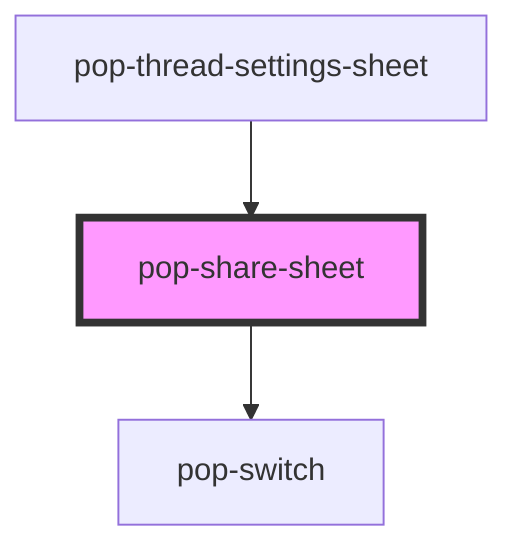

# pop-share-sheet

<!-- Auto Generated Below -->

## Overview

pop-share-sheet — a GENERIC sharing surface.

Deliberately domain-free: it shares a `subject` (`{ kind, id, title }`) with
people and groups. Nothing in here knows the word "thread" — the same
component is meant to serve projects, notes and tasks later.

The sheet is STATELESS with respect to the ACL: every mutation emits
`popAclChange` with a **full replacement array**, never a patch, and waits for
the host to feed the new `acl` back down. That makes the host the single
writer and keeps optimistic-UI drift impossible.

The Link section is Phase 2. It renders DISABLED with a "Coming soon" badge in
V1 on purpose, so the layout does not shift when it lands.

## Properties

| Property      | Attribute      | Description                                                                | Type                | Default     |
| ------------- | -------------- | -------------------------------------------------------------------------- | ------------------- | ----------- |
| `acl`         | --             | The current access-control list.                                           | `AclEntry[]`        | `[]`        |
| `canEdit`     | `can-edit`     | False ⇒ the whole sheet is read-only.                                      | `boolean`           | `false`     |
| `groups`      | --             | Groups the host can resolve. An acl group missing here renders as deleted. | `Group[]`           | `[]`        |
| `linkEnabled` | `link-enabled` | Phase 2 — public link. Rendered disabled in V1.                            | `boolean`           | `false`     |
| `linkUrl`     | `link-url`     | Phase 2 — the public link URL.                                             | `string`            | `''`        |
| `people`      | --             | People the host can resolve, for names and the add-person picker.          | `Member[]`          | `[]`        |
| `redaction`   | --             | Host-owned redaction settings, passed through untouched.                   | `string \| unknown` | `undefined` |
| `subject`     | --             | What is being shared. Free-form `kind` — this component stays domain-free. | `ShareSubject`      | `undefined` |

## Events

| Event                | Description                                            | Type                                 |
| -------------------- | ------------------------------------------------------ | ------------------------------------ |
| `popAclChange`       | The FULL replacement acl. Never a patch.               | `CustomEvent<AclChangeDetail>`       |
| `popLinkToggle`      | Phase 2 — emitted when the public link switch flips.   | `CustomEvent<LinkToggleDetail>`      |
| `popRedactionChange` | Emitted when the host-owned redaction settings change. | `CustomEvent<RedactionChangeDetail>` |

## Dependencies

### Used by

 - [pop-thread-settings-sheet](../thread-settings-sheet)

### Depends on

- [pop-switch](../../atoms/switch)

### Graph

----------------------------------------------

*Built with [StencilJS](https://stenciljs.com/)*
