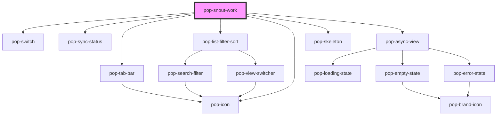

# pop-snout-work

<!-- Auto Generated Below -->

## Overview

pop-snout-work — the **Snout Tasks** team command center (organism), rebuilt
to mirror the hub INVENTORY panel: the shared design-system primitives
(`pop-tab-bar`, `pop-list-filter-sort`, `pop-async-view`, `pop-sync-status`)
over a fat pure-logic split (`snout-work.helpers` + `snout-search`), NOT a
bespoke reinterpretation. Every surface — the compact tab bar with live
per-tab count bubbles, the working search box + funnel filters, the
Project-grouped collapsible sections of dense issue rows, the interactive
status chip, the empty/loading/error states — match the other hub tiles. The
ONLY deviation is the accent: the panel root scopes `--accent` to
`--color-snout-orange`, so the primary/verb buttons + active-tab underline +
focus rings read Snout-orange while everything else inherits the standard look.

PRESENTATION-ONLY over the Bucket Bridge's synced Linear work: the host
(`hub-snout`) owns all IO (fetch `/api/hub/snout`, SWR cache, every write) and
this component renders what it is handed + emits `pop*` events. Search + the
funnel filters are LOCAL client-side state over the loaded snapshot (like
inventory's query) so they function with no round-trip; `tab` is a mutable
prop (host persists it, but it also switches standalone in Storybook).

Object/array props accept a value (property binding) OR a JSON string
(attribute — how Storybook / plain HTML pass them), parsed defensively.

Events (all composed + bubbling):
  popTabChange {tab}                       — Action / Me / Team tab
  popAutoAccept {value}                    — global Auto-accept toggle
  popRefresh / popClose                    — header refresh / close
  popOpenIssue {url} / popOpenProject {url}— open in Linear
  popVerb {taskId,issueId,type,setStatus?} — a contextual verb button tapped
  popStatusChange {taskId,status}          — status change
  popMergePr {taskId,prNumber,url}         — inline PR Merge
  popPostUpdate {projectId}                — per-project Post Update

The expanded row detail is READ-ONLY (the Linear summary) — the breadcrumb
editor (objectives/notes/tdd/summary + comment write-back) was dropped.

## Properties

| Property     | Attribute     | Description                                                                                                                                                                | Type                         | Default                         |
| ------------ | ------------- | -------------------------------------------------------------------------------------------------------------------------------------------------------------------------- | ---------------------------- | ------------------------------- |
| `autoAccept` | `auto-accept` | Global Auto-accept toggle state.                                                                                                                                           | `boolean`                    | `false`                         |
| `commands`   | `commands`    | Recent/active bridgeCommands, for live milestones (object array OR JSON).                                                                                                  | `SnoutCommand[] \| string`   | `[]`                            |
| `counts`     | `counts`      | Server-computed tab counts (object OR JSON string). Used as a fallback; the live bubbles recompute per-tab MATCH counts from the loaded tasks.                             | `SnoutCounts \| string`      | `{ action: 0, me: 0, team: 0 }` |
| `error`      | `error`       | An error line shown in place of the tree (with a Retry → popRefresh).                                                                                                      | `string`                     | `''`                            |
| `loading`    | `loading`     | First-load (no data) → a subtle loader instead of empty.                                                                                                                   | `boolean`                    | `false`                         |
| `projects`   | `projects`    | Projects for group headers + Open ↗ links (object array OR JSON string).                                                                                                   | `SnoutProject[] \| string`   | `[]`                            |
| `showHeader` | `show-header` | Render the panel's own header (logo + title + sync + Auto-accept). Hosts with their own chrome (the hub's PanelShell) set this false — only the tabs + search + list show. | `boolean`                    | `true`                          |
| `syncedAt`   | `synced-at`   | Last successful sync time (epoch ms) for the header's pop-sync-status.                                                                                                     | `number`                     | `undefined`                     |
| `tab`        | `tab`         | Active tab. Mutable so it also switches standalone (Storybook); the host still binds + persists it and listens to popTabChange.                                            | `"action" \| "me" \| "team"` | `'action'`                      |
| `tasks`      | `tasks`       | Whole-team synced tasks (object array OR JSON string).                                                                                                                     | `SnoutTask[] \| string`      | `[]`                            |
| `teamName`   | `team-name`   | The Linear team name (third tab label — "Sonic" for the Snout/ENG team).                                                                                                   | `string`                     | `'Sonic'`                       |

## Events

| Event                    | Description | Type                                                                                                                                           |
| ------------------------ | ----------- | ---------------------------------------------------------------------------------------------------------------------------------------------- |
| `popAutoAccept`          |             | `CustomEvent<{ value: boolean; }>`                                                                                                             |
| `popClose`               |             | `CustomEvent<void>`                                                                                                                            |
| `popCommandAnswerPrompt` |             | `CustomEvent<{ commandId: string; promptId: string; decision: "allow" \| "deny"; updatedInput?: Record<string, unknown>; message?: string; }>` |
| `popCommandSendInbox`    |             | `CustomEvent<{ commandId: string; text: string; }>`                                                                                            |
| `popCommandStop`         |             | `CustomEvent<{ commandId: string; }>`                                                                                                          |
| `popMergePr`             |             | `CustomEvent<{ taskId: string; prNumber: number; url: string; }>`                                                                              |
| `popOpenIssue`           |             | `CustomEvent<{ url: string; }>`                                                                                                                |
| `popOpenProject`         |             | `CustomEvent<{ url: string; }>`                                                                                                                |
| `popPostUpdate`          |             | `CustomEvent<{ projectId: string; }>`                                                                                                          |
| `popRefresh`             |             | `CustomEvent<void>`                                                                                                                            |
| `popStatusChange`        |             | `CustomEvent<{ taskId: string; status: string; }>`                                                                                             |
| `popTabChange`           |             | `CustomEvent<{ tab: SnoutTab; }>`                                                                                                              |
| `popVerb`                |             | `CustomEvent<{ taskId: string; issueId?: string; type: string; setStatus?: string; }>`                                                         |

## Dependencies

### Depends on

- [pop-switch](../../atoms/switch)
- [pop-sync-status](../../molecules/sync-status)
- [pop-tab-bar](../../molecules/tab-bar)
- [pop-list-filter-sort](../list-filter-sort)
- [pop-icon](../../atoms/icon)
- [pop-skeleton](../../atoms/skeleton)
- [pop-async-view](../../molecules/async-view)

### Graph

----------------------------------------------

*Built with [StencilJS](https://stenciljs.com/)*
