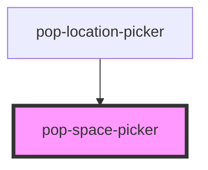

# pop-space-picker

<!-- Auto Generated Below -->

## Properties

| Property      | Attribute      | Description                                                      | Type       | Default            |
| ------------- | -------------- | ---------------------------------------------------------------- | ---------- | ------------------ |
| `allowCreate` | `allow-create` | Whether to show the "+ New space" entry at popover bottom.       | `boolean`  | `true`             |
| `placeholder` | `placeholder`  | Placeholder shown when no spaces are selected.                   | `string`   | `'Select spaces…'` |
| `spaces`      | --             | Available spaces — caller provides; component is presentational. | `Space[]`  | `[]`               |
| `value`       | --             | Currently picked space IDs.                                      | `string[]` | `[]`               |

## Events

| Event                  | Description                                                | Type                                                          |
| ---------------------- | ---------------------------------------------------------- | ------------------------------------------------------------- |
| `spaceCreateRequested` | Emitted when user submits the "+ New space" mini-form.     | `CustomEvent<{ name: string; icon: string; room?: string; }>` |
| `valueChanged`         | Emitted when the picked set changes. Detail = new ID list. | `CustomEvent<string[]>`                                       |

## Dependencies

### Used by

 - [pop-location-picker](../location-picker)

### Graph

----------------------------------------------

*Built with [StencilJS](https://stenciljs.com/)*
