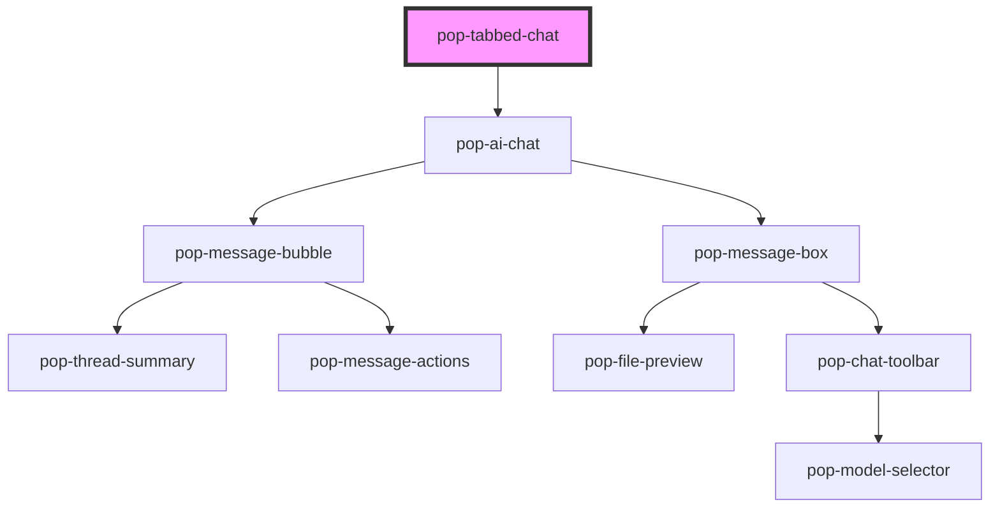

# pop-tabbed-chat

<!-- Auto Generated Below -->

## Properties

| Property          | Attribute           | Description                  | Type                  | Default        |
| ----------------- | ------------------- | ---------------------------- | --------------------- | -------------- |
| `activeSessionId` | `active-session-id` | Currently active session ID  | `string`              | `''`           |
| `activeTools`     | `active-tools`      |                              | `string`              | `'[]'`         |
| `aiAccentColor`   | `ai-accent-color`   |                              | `string`              | `''`           |
| `aiAvatarUrl`     | `ai-avatar-url`     |                              | `string`              | `''`           |
| `aiName`          | `ai-name`           |                              | `string`              | `'Assistant'`  |
| `context`         | `context`           |                              | `string`              | `''`           |
| `endpoint`        | `endpoint`          |                              | `string`              | `''`           |
| `layout`          | `layout`            |                              | `"bubble" \| "prose"` | `'bubble'`     |
| `models`          | `models`            |                              | `string`              | `'[]'`         |
| `placeholder`     | `placeholder`       |                              | `string`              | `'Message...'` |
| `selectedMode`    | `selected-mode`     |                              | `string`              | `'chat'`       |
| `selectedModel`   | `selected-model`    |                              | `string`              | `''`           |
| `sessions`        | `sessions`          | JSON string of ChatSession[] | `string`              | `'[]'`         |
| `showMicButton`   | `show-mic-button`   |                              | `boolean`             | `false`        |
| `streamingMode`   | `streaming-mode`    |                              | `"dots" \| "inline"`  | `'inline'`     |
| `tools`           | `tools`             |                              | `string`              | `'[]'`         |
| `userAvatarUrl`   | `user-avatar-url`   |                              | `string`              | `''`           |
| `userInitials`    | `user-initials`     |                              | `string`              | `''`           |

## Events

| Event                 | Description | Type                                             |
| --------------------- | ----------- | ------------------------------------------------ |
| `popError`            |             | `CustomEvent<string>`                            |
| `popMessageSent`      |             | `CustomEvent<any>`                               |
| `popModeChanged`      |             | `CustomEvent<string>`                            |
| `popModelChanged`     |             | `CustomEvent<string>`                            |
| `popResponseComplete` |             | `CustomEvent<any>`                               |
| `popSessionCreated`   |             | `CustomEvent<void>`                              |
| `popSessionDeleted`   |             | `CustomEvent<string>`                            |
| `popSessionSelected`  |             | `CustomEvent<string>`                            |
| `popToolToggled`      |             | `CustomEvent<{ id: string; enabled: boolean; }>` |

## Methods

### `sendMessage(text: string) => Promise<void>`

#### Parameters

| Name   | Type     | Description |
| ------ | -------- | ----------- |
| `text` | `string` |             |

#### Returns

Type: `Promise<void>`

### `setInputValue(text: string) => Promise<void>`

#### Parameters

| Name   | Type     | Description |
| ------ | -------- | ----------- |
| `text` | `string` |             |

#### Returns

Type: `Promise<void>`

## Dependencies

### Depends on

- [pop-ai-chat](../ai-chat)

### Graph

----------------------------------------------

*Built with [StencilJS](https://stenciljs.com/)*
