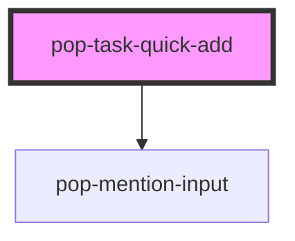

# pop-task-quick-add

<!-- Auto Generated Below -->

## Properties

| Property         | Attribute          | Description                                                                                                                                                                                                         | Type                        | Default     |
| ---------------- | ------------------ | ------------------------------------------------------------------------------------------------------------------------------------------------------------------------------------------------------------------- | --------------------------- | ----------- |
| `defaultQuestId` | `default-quest-id` | Pre-selected quest (when opened from quest detail)                                                                                                                                                                  | `string`                    | `null`      |
| `mentionSources` | --                 | Optional mention sources keyed by group. When provided, the title input is replaced by `<pop-mention-input>` so users can `@`-mention people / `#`-tag etc. When absent, the existing plain-text input is rendered. | `MentionSource[] \| string` | `undefined` |
| `open`           | `open`             | Controls visibility                                                                                                                                                                                                 | `boolean`                   | `false`     |
| `quests`         | `quests`           | JSON array of {id, emoji, title}                                                                                                                                                                                    | `string`                    | `'[]'`      |

## Events

| Event           | Description             | Type                                                                |
| --------------- | ----------------------- | ------------------------------------------------------------------- |
| `quickAddClose` | Popover dismissed       | `CustomEvent<void>`                                                 |
| `taskCreate`    | User submitted the form | `CustomEvent<{ title: string; dueDate: string; questId: string; }>` |

## Dependencies

### Depends on

- [pop-mention-input](../mention-input)

### Graph

----------------------------------------------

*Built with [StencilJS](https://stenciljs.com/)*
