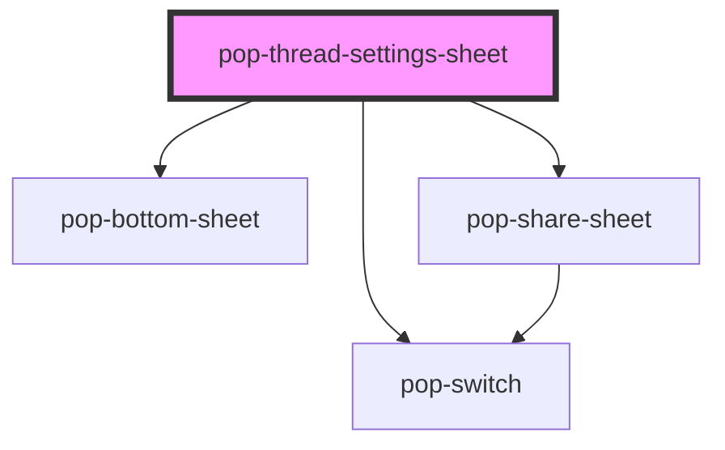

# pop-thread-settings-sheet

<!-- Auto Generated Below -->

## Overview

pop-thread-settings-sheet — the per-thread settings surface.

Three sections in one `pop-bottom-sheet`: Notifications, Channels and Sharing
(which simply embeds the generic `pop-share-sheet`).

Two things this component is deliberately loud about:
 1. **Muting is not un-mirroring.** Muting a thread changes NOTIFICATIONS
    only; a bound channel keeps delivering every post. The copy says so at
    the mute control, because getting this wrong means a "muted" thread that
    keeps buzzing the user's phone.
 2. **Noisy threads warn before binding.** Past ~20 posts a week, enabling a
    channel is a firehose, so the switch asks for an explicit confirm and the
    resulting `popChannelToggle` carries `force: true`.

## Properties

| Property              | Attribute           | Description                                                        | Type                             | Default     |
| --------------------- | ------------------- | ------------------------------------------------------------------ | -------------------------------- | ----------- |
| `acl`                 | --                  |                                                                    | `AclEntry[]`                     | `[]`        |
| `available`           | --                  | Channels the user could bind, with their addresses.                | `AvailableChannel[]`             | `[]`        |
| `canBind`             | `can-bind`          | False ⇒ the user may not bind or unbind channels.                  | `boolean`                        | `false`     |
| `canEdit`             | `can-edit`          |                                                                    | `boolean`                        | `false`     |
| `channels`            | --                  | Channels this thread is already mirrored to.                       | `BoundChannel[]`                 | `[]`        |
| `groups`              | --                  |                                                                    | `Group[]`                        | `[]`        |
| `notifyLevel`         | `notify-level`      |                                                                    | `"all" \| "mentions" \| "muted"` | `'all'`     |
| `open`                | `open`              |                                                                    | `boolean`                        | `false`     |
| `people`              | --                  |                                                                    | `Member[]`                       | `[]`        |
| `recentPostCount`     | `recent-post-count` | Posts in the last week — drives the noise warning.                 | `number`                         | `0`         |
| `thread` _(required)_ | --                  | The thread being configured. Title only — no data is fetched here. | `{ id: string; title: string; }` | `undefined` |

## Events

| Event              | Description                                     | Type                               |
| ------------------ | ----------------------------------------------- | ---------------------------------- |
| `popAclChange`     | Re-emitted from the embedded `pop-share-sheet`. | `CustomEvent<AclChangeDetail>`     |
| `popChannelToggle` |                                                 | `CustomEvent<ChannelToggleDetail>` |
| `popClose`         |                                                 | `CustomEvent<void>`                |
| `popNotifyChange`  |                                                 | `CustomEvent<NotifyChangeDetail>`  |

## Dependencies

### Depends on

- [pop-switch](../../atoms/switch)
- [pop-bottom-sheet](../../molecules/bottom-sheet)
- [pop-share-sheet](../share-sheet)

### Graph

----------------------------------------------

*Built with [StencilJS](https://stenciljs.com/)*
