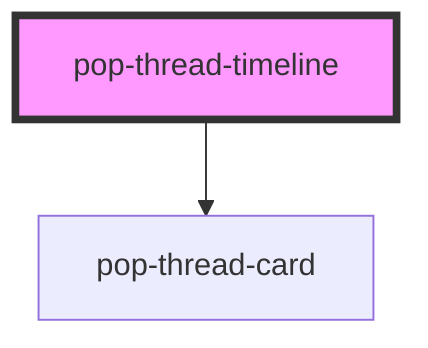

# pop-thread-timeline

<!-- Auto Generated Below -->

## Overview

pop-thread-timeline — the Thread Model v2 timeline.

Renders a pre-sorted list of thread items: messages as bubbles, cards through
the `pop-thread-card` wrapper with an INJECTED renderer tag. The component is
pure props-in / events-out — it never fetches, never touches Firebase, and
**never re-sorts `items`**; the server owns the order.

The `renderers` map (cardType → `pop-*` tag) is injected too, so ui-kit depends
on no card registry. A cardType missing from the map falls through to the
wrapper's fallback face rather than blanking the row.

## Properties

| Property         | Attribute         | Description                                                             | Type           | Default |
| ---------------- | ----------------- | ----------------------------------------------------------------------- | -------------- | ------- |
| `canParticipate` | `can-participate` | False ⇒ viewer mode: no action buttons, no reply/check-off affordances. | `boolean`      | `true`  |
| `currentUid`     | `current-uid`     | The viewing user; drives own-vs-other bubble rendering.                 | `string`       | `''`    |
| `items`          | --                | Items in SERVER order — oldest first. Never re-sorted here.             | `ThreadItem[]` | `[]`    |
| `loadingOlder`   | `loading-older`   | Shows the top spinner while older items are being fetched.              | `boolean`      | `false` |
| `renderers`      | --                | cardType → `pop-*` renderer tag. Injected; ui-kit holds no registry.    | `string`       | `{}`    |

## Events

| Event            | Description                                                     | Type                                  |
| ---------------- | --------------------------------------------------------------- | ------------------------------------- |
| `popItemAction`  | A card action fired from inside an item.                        | `CustomEvent<ThreadItemActionDetail>` |
| `popItemPromote` | Promote a message into a card / task.                           | `CustomEvent<ThreadItemRefDetail>`    |
| `popItemReply`   | The user wants to reply to an item.                             | `CustomEvent<ThreadItemRefDetail>`    |
| `popItemStatus`  | Check-off: open → done → open, or dismissed.                    | `CustomEvent<ThreadItemStatusDetail>` |
| `popLoadOlder`   | Infinite scroll upward — cursor is the oldest rendered item id. | `CustomEvent<ThreadLoadOlderDetail>`  |

## Methods

### `appendItem(item: ThreadItem) => Promise<void>`

Append a live (SSE) item without asking the host to rebuild `items`.

#### Parameters

| Name   | Type         | Description |
| ------ | ------------ | ----------- |
| `item` | `ThreadItem` |             |

#### Returns

Type: `Promise<void>`

### `scrollToItem(id: string) => Promise<void>`

Scroll a given item into view — used by search and back-reference stubs.

#### Parameters

| Name | Type     | Description |
| ---- | -------- | ----------- |
| `id` | `string` |             |

#### Returns

Type: `Promise<void>`

## Dependencies

### Depends on

- [pop-thread-card](../../molecules/thread-card)

### Graph

----------------------------------------------

*Built with [StencilJS](https://stenciljs.com/)*
