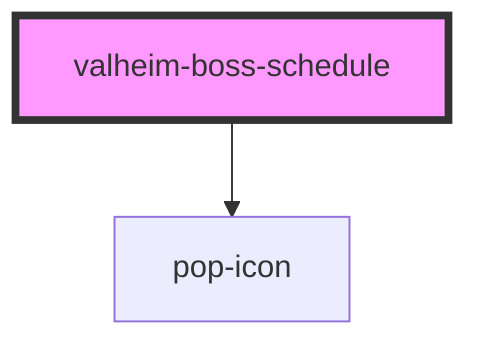

# valheim-boss-schedule

<!-- Auto Generated Below -->

## Overview

`valheim-boss-schedule` — the trials block of the Popcorn's Pantheon
surfaces: the next-trial target card (+ live trial-night countdown + RSVP
row) and the agenda list. Theme-agnostic via the `--vlh-*` token layer.

TRIAL SECRECY / NEXT-ONLY (the standardization rule both surfaces share):
players see ONLY announced (`revealed`) + past trials — everything else
collapses into ONE sealed teaser row ("??? · the gods reveal one trial at a
time") so not even the season's length or week numbering leaks (player rows
also drop their `week` labels). `isAdmin` overrides and shows the full
agenda with week slots (the hub panel is admin-facing). The finale row stays
sealed to players until the season-end reveal.

## Properties

| Property      | Attribute       | Description                                                                                                                         | Type      | Default        |
| ------------- | --------------- | ----------------------------------------------------------------------------------------------------------------------------------- | --------- | -------------- |
| `bossNightAt` | `boss-night-at` | Epoch ms of the next boss night (drives the countdown).                                                                             | `number`  | `undefined`    |
| `bosses`      | `bosses`        | JSON array of ValheimBossItem, season order.                                                                                        | `string`  | `'[]'`         |
| `heading`     | `heading`       |                                                                                                                                     | `string`  | `'The trials'` |
| `isAdmin`     | `is-admin`      | Admin view — full schedule, sealed rows included.                                                                                   | `boolean` | `false`        |
| `rsvpCount`   | `rsvp-count`    | Raiders who answered the horn for the current boss night.                                                                           | `number`  | `undefined`    |
| `rsvpCta`     | `rsvp-cta`      | Show the "Answer the horn" CTA on the RSVP row. Admin dashboards that only MONITOR the count (the RSVP flow is bot-run) pass false. | `boolean` | `true`         |
| `showList`    | `show-list`     | Render the agenda list (false = the Overview "next trial" glance).                                                                  | `boolean` | `true`         |

## Events

| Event         | Description                                | Type                |
| ------------- | ------------------------------------------ | ------------------- |
| `valheimRsvp` | RSVP button — the HOST records the answer. | `CustomEvent<void>` |

## Dependencies

### Depends on

- [pop-icon](../../atoms/icon)

### Graph

----------------------------------------------

*Built with [StencilJS](https://stenciljs.com/)*
