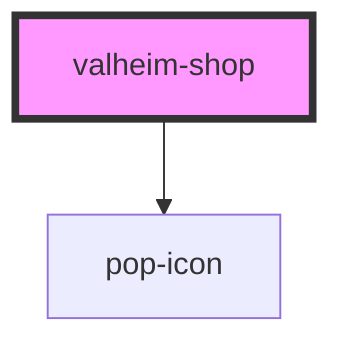

# valheim-shop

<!-- Auto Generated Below -->

## Overview

`valheim-shop` — the curated-economy block of the Valheim raid-league
surfaces: current tier, Haldor's stock (locked rows show their unlock gate),
and the bot's weekly stock/unlock PROPOSAL awaiting the Jarl's word.
Theme-agnostic via the `--vlh-*` token layer.

Admin approve/tweak render only when `isAdmin`; the component emits
`valheimShopAction` and the host performs the real action (a
`valheimCommands` outbox write the valheim-agent applies to the
TradersExtended/WAP configs).

## Properties

| Property   | Attribute  | Description                                                   | Type      | Default           |
| ---------- | ---------- | ------------------------------------------------------------- | --------- | ----------------- |
| `heading`  | `heading`  |                                                               | `string`  | `"Haldor's shop"` |
| `isAdmin`  | `is-admin` | Admin surfaces get the approve/tweak actions on the proposal. | `boolean` | `false`           |
| `items`    | `items`    | JSON array of ValheimShopWare.                                | `string`  | `'[]'`            |
| `proposal` | `proposal` | JSON ValheimShopProposal ('' = no pending proposal).          | `string`  | `''`              |
| `tier`     | `tier`     | JSON ValheimShopTier ('' = no tier yet).                      | `string`  | `''`              |

## Events

| Event               | Description                                  | Type                                              |
| ------------------- | -------------------------------------------- | ------------------------------------------------- |
| `valheimShopAction` | Approve/tweak tapped — the HOST performs it. | `CustomEvent<{ action: ValheimShopActionKind; }>` |

## Dependencies

### Depends on

- [pop-icon](../../atoms/icon)

### Graph

----------------------------------------------

*Built with [StencilJS](https://stenciljs.com/)*
