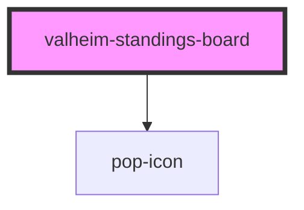

# valheim-standings-board

<!-- Auto Generated Below -->

## Overview

`valheim-standings-board` — "The Pantheon", the hall-of-the-worthy standings
block of the Popcorn's Pantheon surfaces. Theme-agnostic via the `--vlh-*`
token layer.

The Pantheon (default view) is CO-OP: bounties · coin · bosses · Falls
(deaths to the world — playful ribbing, never PvP kills), with medal ranks.
Juggernaut: the hidden FINALE bounty board — PvP banner, the current target
and their price. The Juggernaut toggle only renders once the finale is
`active` (or for admins) — PvP is never the everyday framing, and the
toggle's existence would leak the season-end twist to players.

## Properties

| Property     | Attribute    | Description                                                        | Type      | Default          |
| ------------ | ------------ | ------------------------------------------------------------------ | --------- | ---------------- |
| `heading`    | `heading`    |                                                                    | `string`  | `'The Pantheon'` |
| `isAdmin`    | `is-admin`   | Admins see the Juggernaut toggle even before the finale goes live. | `boolean` | `false`          |
| `juggernaut` | `juggernaut` | JSON ValheimJuggernautState ('' = no finale state yet).            | `string`  | `''`             |
| `standings`  | `standings`  | JSON array of ValheimStandingRow, rank order.                      | `string`  | `'[]'`           |

## Dependencies

### Depends on

- [pop-icon](../../atoms/icon)

### Graph

----------------------------------------------

*Built with [StencilJS](https://stenciljs.com/)*
