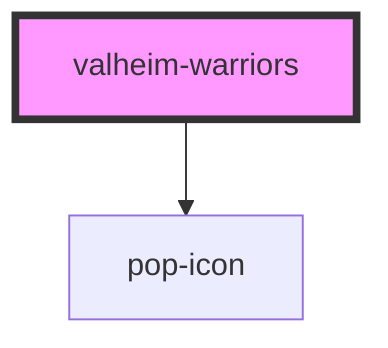

# valheim-warriors

<!-- Auto Generated Below -->

## Overview

`valheim-warriors` — the online-roster + server-health block of the Valheim
raid-league surfaces (hub panel + public event page). Theme-agnostic: ALL
color/shape rides the `--vlh-*` token layer (styles/valheim-skins.css) so
the same component renders hub-native under `.vlh-skin--hub` and in-universe
under `.vlh-skin--norse`.

Admin server ops (restart / stop / backup) render only when `isAdmin`; the
component never talks to a backend — it emits `valheimServerAction` and the
host (hub-valheim) enqueues the real `valheimCommands` outbox doc.

## Properties

| Property     | Attribute     | Description                                                     | Type      | Default             |
| ------------ | ------------- | --------------------------------------------------------------- | --------- | ------------------- |
| `heading`    | `heading`     |                                                                 | `string`  | `'Warriors online'` |
| `health`     | `health`      | JSON ValheimServerHealth.                                       | `string`  | `'{}'`              |
| `isAdmin`    | `is-admin`    | Admin surfaces get the server-ops row.                          | `boolean` | `false`             |
| `maxPlayers` | `max-players` |                                                                 | `number`  | `undefined`         |
| `online`     | `online`      | Server reachability (drives the header tone; ops still render). | `boolean` | `true`              |
| `players`    | `players`     | JSON array of ValheimWarrior.                                   | `string`  | `'[]'`              |

## Events

| Event                 | Description                                              | Type                                                |
| --------------------- | -------------------------------------------------------- | --------------------------------------------------- |
| `valheimServerAction` | Admin op tapped — the HOST performs it (outbox enqueue). | `CustomEvent<{ action: ValheimServerActionKind; }>` |

## Dependencies

### Depends on

- [pop-icon](../../atoms/icon)

### Graph

----------------------------------------------

*Built with [StencilJS](https://stenciljs.com/)*
