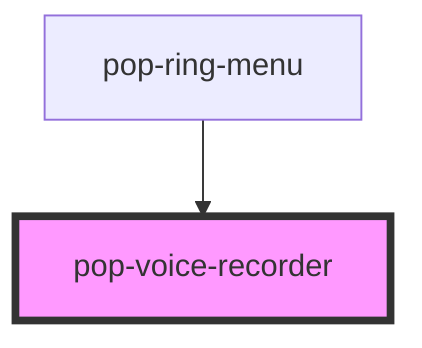

# pop-voice-recorder

<!-- Auto Generated Below -->

## Properties

| Property    | Attribute | Description                                                                 | Type                        | Default      |
| ----------- | --------- | --------------------------------------------------------------------------- | --------------------------- | ------------ |
| `audioBlob` | --        | Pre-recorded blob to start in collapsed mode                                | `Blob`                      | `undefined`  |
| `mode`      | `mode`    | Visual mode: 'expanded' = active recording bar, 'collapsed' = ring playback | `"collapsed" \| "expanded"` | `'expanded'` |

## Events

| Event               | Description                                               | Type                |
| ------------------- | --------------------------------------------------------- | ------------------- |
| `recordingCancel`   | Emitted when the user cancels                             | `CustomEvent<void>` |
| `recordingComplete` | Emitted when recording is saved — detail is the AudioBlob | `CustomEvent<Blob>` |

## Methods

### `begin() => Promise<void>`

Call this to begin recording — only invoke from an explicit user gesture.

#### Returns

Type: `Promise<void>`

## Dependencies

### Used by

 - [pop-ring-menu](../ring-menu)

### Graph

----------------------------------------------

*Built with [StencilJS](https://stenciljs.com/)*
