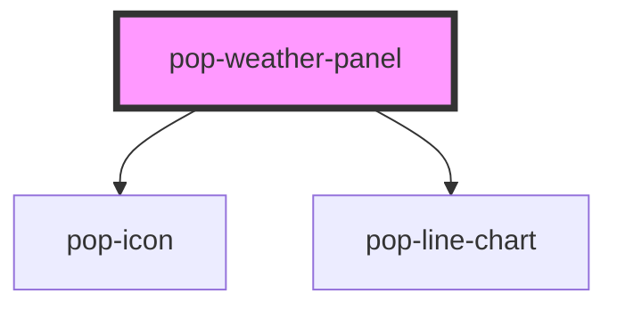

# pop-weather-panel

<!-- Auto Generated Below -->

## Properties

| Property     | Attribute     | Description                                                                                                                                                                                                                                                                                                                                                                                | Type                         | Default     |
| ------------ | ------------- | ------------------------------------------------------------------------------------------------------------------------------------------------------------------------------------------------------------------------------------------------------------------------------------------------------------------------------------------------------------------------------------------ | ---------------------------- | ----------- |
| `data`       | `data`        | The forecast to render. Accepts a `WeatherPanelData` object (property binding) OR a JSON string (attribute — how Storybook / plain HTML pass it).                                                                                                                                                                                                                                          | `WeatherPanelData \| string` | `{}`        |
| `heading`    | `heading`     | Panel heading (shown top-left in the header).                                                                                                                                                                                                                                                                                                                                              | `string`                     | `'Weather'` |
| `loading`    | `loading`     | Loading state — renders a subtle skeleton/spinner instead of the forecast.                                                                                                                                                                                                                                                                                                                 | `boolean`                    | `false`     |
| `showHeader` | `show-header` | Render the panel's own header (heading + place + refresh). Default true so the component is self-contained (Storybook / standalone). A HOST that supplies its OWN chrome — e.g. the Bucket Hub's PanelShell header with a `pop-sync-status` refresh + `pop-location` trigger — sets `showHeader={false}` so the body (current block + tabs + forecast) renders without a duplicate header. | `boolean`                    | `true`      |

## Events

| Event          | Description                                                       | Type                               |
| -------------- | ----------------------------------------------------------------- | ---------------------------------- |
| `popRefresh`   | Fires when the header refresh button is pressed (host refetches). | `CustomEvent<void>`                |
| `popTabChange` | Fires when the user switches the Hourly / Daily tab.              | `CustomEvent<"daily" \| "hourly">` |

## Dependencies

### Depends on

- [pop-icon](../../atoms/icon)
- [pop-line-chart](../../molecules/line-chart)

### Graph

----------------------------------------------

*Built with [StencilJS](https://stenciljs.com/)*
